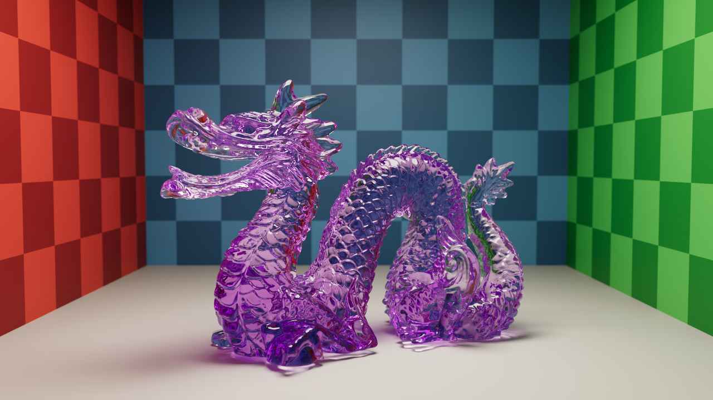
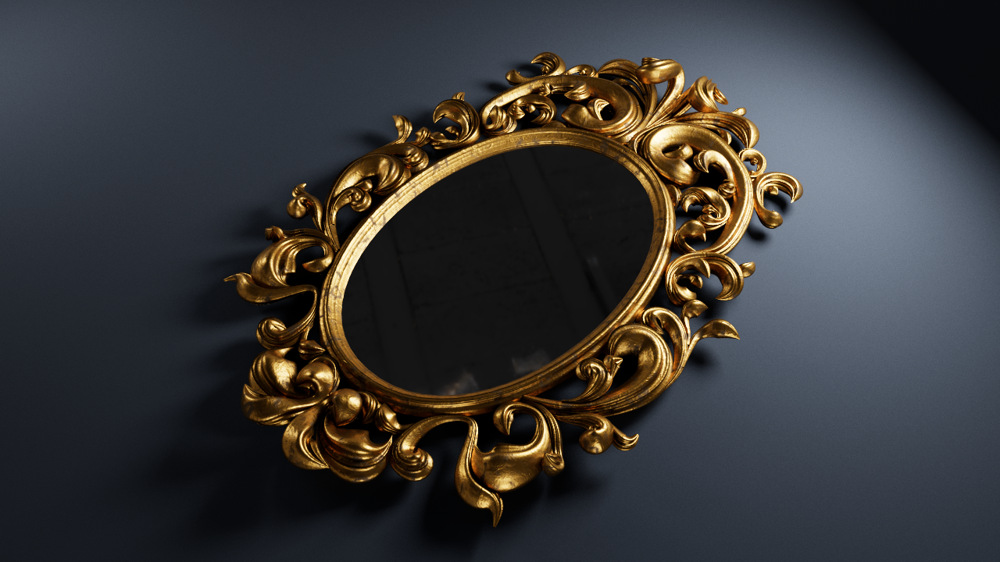
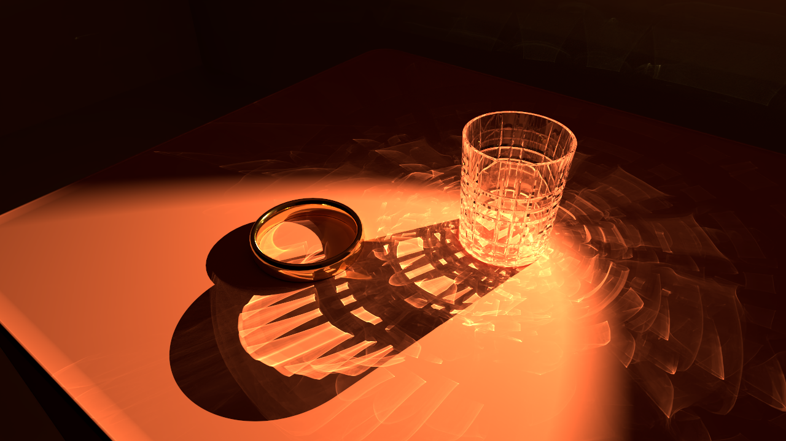
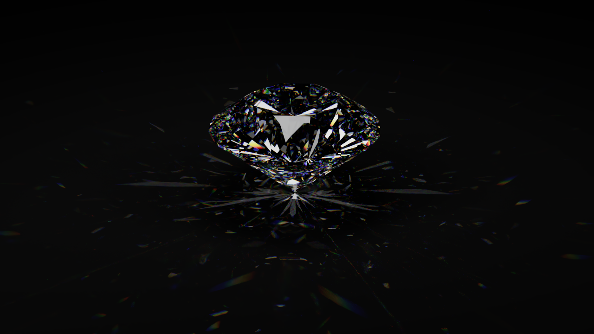

# CUDA Path Tracer

Path tracer CUDA interactif qui implémente plusieurs techniques de rendu physiquement réaliste.

[](img/dragon_cornell_4k.png)
[](img/mirror_4k.png)
[](img/caustics_4k.png)
[](img/diamond_4k.png)

## Techniques

**Accélération**

- BVH construit avec la SAH par binning ([Wald 2007](https://doi.org/10.1109/RT.2007.4342588))
- Intersection rayon-triangle ([Möller et Trumbore 1997](https://doi.org/10.1080/10867651.1997.10487468))
- Threads persistants ([Aila et Laine 2009](https://doi.org/10.1145/1572769.1572792)) et régénération des chemins ([Novák et al. 2010](https://doi.org/10.2312/egsh.20101048))

**Transport de la lumière**

- Path tracing ([Kajiya 1986](https://doi.org/10.1145/15886.15902)) avec roulette russe ([Arvo et Kirk 1990](https://doi.org/10.1145/97880.97886))
- Éclairage direct et MIS avec l'heuristique de puissance ([Veach et Guibas 1995](https://doi.org/10.1145/218380.218498)), lumières tirées selon leur puissance
- Caustiques par photon mapping ([Jensen 1996](https://doi.org/10.1007/978-3-7091-7484-5_3)) progressif ([Knaus et Zwicker 2011](https://doi.org/10.1145/1966394.1966404)), photons émis vers le verre et le métal poli, grille de hachage sur GPU ([Teschner et al. 2003](https://matthias-research.github.io/pages/publications/tetraederCollision.pdf))
- HDRI échantillonnée selon sa luminance ([Pharr et al. 2023](https://pbr-book.org/4ed/))

**Matériaux**

- Modèle metallic-roughness de glTF 2.0 : microfacettes GGX, masquage de Smith corrélé en hauteur ([Heitz 2014](https://jcgt.org/published/0003/02/03/)), tirage des normales visibles ([Dupuy et Benyoub 2023](https://doi.org/10.1111/cgf.14867)), Fresnel de [Schlick 1994](https://doi.org/10.1111/1467-8659.1330233)
- Verre lisse et dépoli ([Walter et al. 2007](https://doi.org/10.2312/EGWR/EGSR07/195-206)), absorption de Beer-Lambert
- Dispersion spectrale (`KHR_materials_dispersion`) avec les fonctions colorimétriques CIE de [Wyman et al. 2013](https://jcgt.org/published/0002/02/01/)
- Textures de couleur, metallic-roughness et émission, normal mapping, terminateur d'ombre ([Chiang et al. 2019](https://doi.org/10.1145/3306307.3328172))

**Caméra et image**

- Profondeur de champ par lentille mince ([Cook et al. 1984](https://doi.org/10.1145/800031.808590)), mapping concentrique du disque ([Shirley et Chiu 1997](https://doi.org/10.1080/10867651.1997.10487479))
- Tone mapping AgX ([Wrensch 2024](https://iolite-engine.com/blog_posts/minimal_agx_implementation)), ACES ([Hill](https://github.com/TheRealMJP/BakingLab/blob/master/BakingLab/ACES.hlsl)) ou Standard
- Débruiteur OptiX avec les couches d'albédo et de normales

## Dépendances

CMake 4.4+, un compilateur C++23, le CUDA Toolkit 13+, un GPU NVIDIA Turing ou plus récent, ainsi que les paquets de développement GLFW 3.4 et OpenGL. fastgltf, Dear ImGui, OptiX, TinyEXR, stb et Catch2 sont récupérés automatiquement à la configuration.

## Usage

```sh
cmake --preset release
cmake --build --preset release
./build/release/src/app/raytracer scene.glb [--hdri environnement.exr]
```

## Ressources

- [Set of Four Whiskey Glasses - Tomato](https://faketomato.gumroad.com/l/XQCGHt)
- [Curve Bevel Profile - Daniel Bystedt](https://www.blender.org/download/demo-files/)
- [Stanford Dragon - Stanford Computer Graphics Laboratory](https://graphics.stanford.edu/data/3Dscanrep/)
- [Monochrome Studio 03 - Poly Haven](https://polyhaven.com/a/monochrome_studio_03)

## Licence

[MIT](LICENSE)
